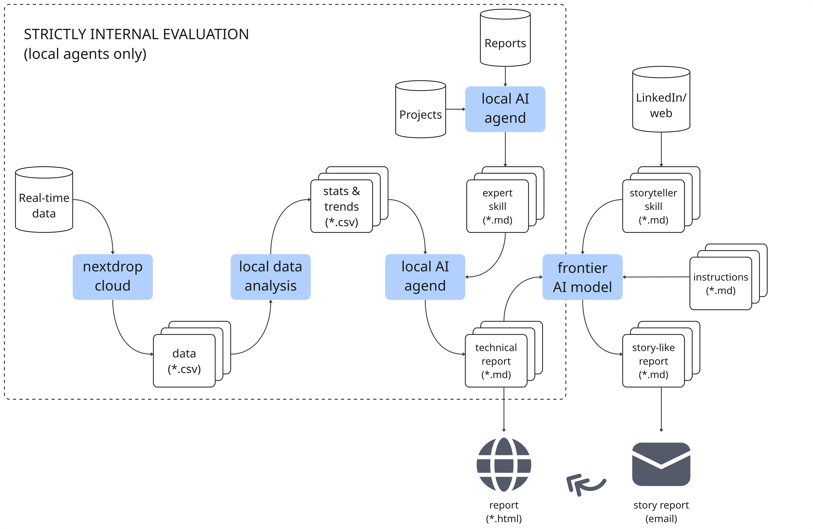

# bizhack

Public repository for the **BizHack AI Marketing Hackathon** — combining Python time-series analytics for building water consumption data with an AI-agent workflow that transforms raw sensor telemetry into engineering reports and data-driven stories.



## Overview

This repository provides:

1. **Water Flow Datasets (`data/series-1` – `data/series-5`)** — Real-world-inspired building water flow time series with varying encodings, units, sampling intervals, and anomaly types (pool top-up leaks, daytime/overnight bursts, chronic baseline leaks, and pulse-quantized telemetry).
2. **Time-Series Analysis CLI (`analyze_series.py` / `analysis/`)** — Automatically detects encoding (UTF-16 LE BOM vs. UTF-8), normalizes mixed units (`mL`, `L`, `kL`) to liters, handles missing values and irregular intervals, computes statistical/trend/diurnal/period metrics, and exports tidy CSV reports.
3. **AI Agent Skills & Workflow (`workflow.md`, `expert_skill.md`, `storyteller_skill.md`)** — Structured prompts and instructions guiding an AI agent from quantitative technical analysis (`technical_report.md`) to accessible data storytelling (`story-like_report.md`) and infographic design.

## Repository Structure

```text
.
├── analyze_series.py       # CLI entrypoint for time-series analysis
├── analysis/
│   ├── loader.py           # Encoding detection, unit normalization (mL/L/kL), timestamp parsing
│   ├── analyzer.py         # Descriptive stats, trend tests, diurnal & period metrics, anomaly flags
│   ├── exporter.py         # Tidy CSV exporter
│   └── cli.py              # Argument parser and CLI runner
├── data/
│   ├── series-1/           # Commercial office building (Flow + Subflow pool top-up leak)
│   ├── series-2/           # School building (Day 1 anomaly, irregular polling intervals)
│   ├── series-3/           # School building (multi-day leak on Days 2–4)
│   ├── series-4/           # Commercial office building (baseline leak -> Day 8 pipe burst -> repair)
│   └── series-5/           # Public facility (high visitor load + overnight continuous flow events)
├── tests/
│   └── test_analysis.py    # Unit and end-to-end CLI tests (unittest)
├── expert_skill.md         # Senior water-management data analyst persona & protocol
├── storyteller_skill.md    # Water data storytelling & copywriting persona & protocol
├── workflow.md             # End-to-end AI agent execution workflow
├── workflow.png            # Visual diagram of the workflow (also available as workflow.pdf)
├── AGENTS.md               # Repository data parsing notes for coding agents
└── LICENSE                 # MIT License
```

## Datasets

All included datasets live under `data/series-*/data.csv` with accompanying descriptions in `data/series-*/README.md`. Values are already scaled into volume units (`mL`, `L`, or `kL`); the loader normalizes all flow columns to liters (`L`).

| Series | Facility Type | Columns | Encoding | Sampling | Key Characteristics |
| :--- | :--- | :--- | :--- | :--- | :--- |
| `series-1` | Commercial office (100–200 occupants) | `Flow`, `Subflow` | UTF-16 LE | Regular 60 s (4 days) | Pool top-up leakage isolated in `Subflow`; `k = 10 L/pulse` |
| `series-2` | School building | `Flow` | UTF-16 LE | Irregular 40–79 s (5 days) | Day 1 anomaly; near-zero night flow; synchronized daytime peaks |
| `series-3` | School building | `Flow` | UTF-8 | Regular 60 s (5 days) | Multi-day leak across Days 2–4; mixed `L`/`mL`; `k = 1 L/pulse` |
| `series-4` | Commercial office | `Flow` | UTF-8 | 60 s + 21 gaps (10 days) | Chronic baseline leak → Day 8 pipe burst → post-repair drop; `k = 0.1 L/pulse` |
| `series-5` | Public facility (500–1,000 visitors/day) | `Flow` | UTF-8 | 60 s + 209 gaps (7 days) | High daytime load + two overnight continuous-flow runs; `k = 100 L/pulse` |

## Requirements

- Python **3.11+**
- Python packages: `numpy`, `pandas`, `scipy`

Install dependencies:

```bash
pip install numpy pandas scipy
```

## Usage

Run the statistical and trend analysis on a named series (output defaults to `output/<series>_analysis.csv`):

```bash
python3 analyze_series.py --series series-1
```

Or specify a custom CSV path and output destination:

```bash
python3 analyze_series.py --series series-1 -o output/analysis.csv
python3 -m analysis --series data/series-4/data.csv -o output/series-4_analysis.csv
```

### CLI Options

| Flag | Description |
| :--- | :--- |
| `--series` | Required. Series name under `--data-dir` (e.g. `series-1`..`series-5`) or path to a CSV file. |
| `-o`, `--output` | Output CSV file path (default: `output/<series>_analysis.csv`). |
| `--data-dir` | Base directory containing `series-*` folders (default: `data`). |
| `-q`, `--quiet` | Suppress stdout summary output. |

### Output CSV Format

The exporter writes a tidy UTF-8 CSV with columns:

```text
series,section,period,series_column,metric,value,unit
```

Computed sections include:
- `data_quality` — encoding, row count, time span, duplicates, sampling intervals, and gap counts
- `overall_stats` — total volume, mean, std, CV, quantiles (`p10`–`p99`), skewness, kurtosis, zero/non-zero ratios, and `Flow`/`Subflow` correlation when both exist
- `overall_trend` — hourly OLS, Theil-Sen slope & 95% CI, Mann-Kendall (`tau`), Spearman (`rho`), 6 h / 24 h rolling peaks, daily volume OLS, and first- vs. second-half change
- `diurnal_profile` — night (`00:00–05:59`), daytime (`06:00–17:59`), evening (`18:00–23:59`), night-to-day ratio, peak/min hours
- `daily_stats`, `daily_trend`, `week_stats`, `month_stats`, `year_stats` — period totals, deltas, intraday/within-period slopes, robust z-scores, and `elevated_day_flag` / `elevated_overnight_flag` anomaly indicators

## AI Reporting Workflow

The workflow in `workflow.md` demonstrates an end-to-end AI reporting loop:

1. Run `analyze_series.py` on a target dataset to produce `analysis.csv`.
2. Apply the analytical persona in `expert_skill.md` to evaluate raw telemetry + statistical outputs and write `technical_report.md`.
3. Apply the storytelling persona in `storyteller_skill.md` to translate the key technical findings into a concise narrative (`story-like_report.md`) and visual brief/infographic.

## Running Tests

Execute the unit and end-to-end CLI test suite:

```bash
python3 -m unittest discover -s tests
```

## License

This project is licensed under the **MIT License** — see the [LICENSE](LICENSE) file for details.
